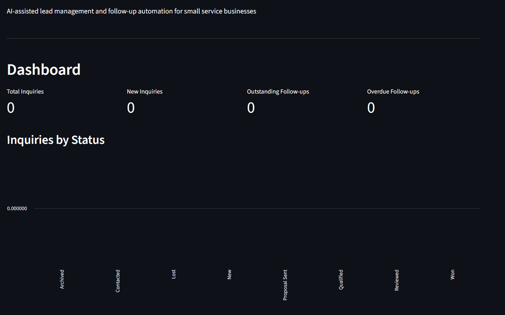

# Intelligent Lead Management & Follow-Up System

An AI-powered application for managing and tracking customer inquiries across multiple channels including Gmail, WhatsApp, Instagram, Telegram, Facebook Messenger, and website forms. Automatically captures, prioritizes, and tracks customer inquiries with AI-powered insights and automated follow-up reminders.

## 📸 Preview



## ✨ Features

- **Multi-Channel Intake**: Capture inquiries from Gmail, WhatsApp, Instagram, Facebook Messenger, Telegram, and website forms
- **AI-Powered Processing**: AI-driven analysis of inquiry content to extract key information, sentiment, and intent
- **Automatic Deduplication**: Intelligent duplicate detection prevents duplicate inquiries from cluttering your pipeline
- **Follow-Up Management**: Track and manage follow-up tasks with due dates and status tracking
- **Response Drafting**: AI-generated response drafts for quick customer communication
- **Dashboard & Reporting**: Visual dashboard with inquiry statistics, source breakdown, and priority distribution
- **SQLCipher Encryption**: All data stored in encrypted SQLite databases for security
- **Test Coverage**: Comprehensive test suite covering database integrity, backup/recovery, dashboard rendering, and UI rendering

## 🚀 Quick Start

### Prerequisites

- Python 3.10 or higher
- SQLCipher (included via `sqlcipher3` package)

### Installation

```bash
# Clone the repository
git clone https://github.com/solomonogunyeye/intelligent-lead-management-system.git
cd intelligent-lead-management-system

# Install dependencies
pip install -e .

# For browser adapter support:
pip install -e ".[browser]"

# For Gmail integration:
pip install -e ".[gmail]"
```

### Running the Application

```bash
# Initialize the database
python run.py init-db

# Start the application
python run.py
```

The application will be available at `http://localhost:8503`.

### Environment Configuration

Copy `.env.example` to `.env` and configure as needed:

```bash
cp .env.example .env
```

Edit `.env` with your configuration values. Never commit actual credentials to version control.

---

## 🏗️ Architecture

The application follows a modular architecture:

```
leadlift/
├── __init__.py
├── config.py          # Configuration management
├── config.py          # Settings and configuration
├── db.py              # Database layer with SQLCipher encryption
├── key_management.py  # Encryption key management
├── logging_config.py  # Logging configuration
├── models.py          # Data models (Inquiry, FollowUpTask, ResponseDraft)
├── repository.py      # Data access layer
├── status.py          # Status tracking
├── tasks.py           # Task and follow-up management
├── ui.py              # Streamlit UI interface
├── schema.sql         # Database schema
├── adapters/
│   ├── __init__.py
│   ├── browser.py          # Website form intake
│   ├── email.py            # Gmail integration
│   ├── facebook.py         # Facebook Messenger
│   ├── instagram.py      # Instagram Direct Messages
│   ├── telegram.py         # Telegram Bot
│   └── website_form.py   # Website form intake
└── ai/
    ├── __init__.py
    ├── processor.py      # AI processing pipeline
    └── validation.py     # Response validation
tests/
├── test_backup.py
├── test_db_health.py
├── test_db_integrity.py
└── test_ui_rendering.py
```

## 🔒 Security

- All data is stored in SQLCipher-encrypted SQLite databases
- Encryption keys are managed securely via the system keyring
- No credentials or secrets are stored in version control
- Configuration is handled via `.env` files (see `.env.example`)

## 🧪 Testing

Run the test suite:

```bash
pytest tests/
```

## 📄 License

This project is provided as-is for portfolio and educational purposes. Important information excluded under Non-disclosure.

---

**Note**: This repository contains the application source code and tests. Database files, logs, and other runtime artifacts are not included in the repository.
